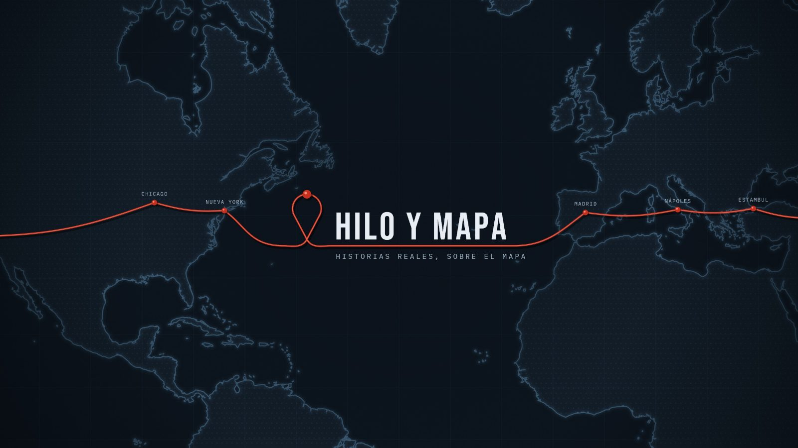
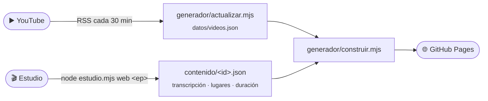

<div align="center">



# Hilo y Mapa · Web oficial

**La web del canal documental [Hilo y Mapa](https://www.youtube.com/@hiloymapa): cada caso con su mapa, capítulos, transcripción, fuentes y créditos.**<br>
Se actualiza sola cuando sale un vídeo nuevo.


</div>

## Cómo se actualiza



1. **Automático.** Una Action lee el RSS público del canal cada 30 minutos (sin claves). Si hay un vídeo nuevo, lo guarda en `datos/videos.json` y publica la web. El título, el resumen, los capítulos, las fuentes y los créditos salen de la descripción del vídeo. Los Shorts se distinguen solos y se enlazan a su documental.
2. **Contenido del estudio.** `node estudio.mjs web <episodio>`, en el repositorio del estudio, envía aquí `contenido/<videoId>.json` con lo que el RSS no trae: la transcripción por capítulos, los lugares del mapa con coordenadas, la duración y la cifra de datos verificados. El push vuelve a publicar la web.

Los slugs se fijan la primera vez que se ve un vídeo y no cambian aunque cambie el título (pruebas A/B), así que los enlaces no se rompen.

## Qué genera

| Archivo | Para qué |
|---|---|
| `index.html` | Portada con el mapa animado, el último caso, todos los casos, Shorts, el mapa interactivo y el método |
| `casos/<slug>/` | Cada caso: reproductor sin cookies, mapa del recorrido, capítulos que saltan al minuto, transcripción, fuentes y créditos |
| `sobre/` | El método, las normas editoriales, cifras, preguntas frecuentes y privacidad |
| `sitemap.xml` | Con extensión de vídeo de Google |
| `robots.txt` | Abierto a buscadores y asistentes de IA |
| `llms.txt` · `llms-full.txt` | Resumen y texto completo para asistentes ([llmstxt.org](https://llmstxt.org)) |
| `feed.xml` | Atom con los casos |

En cada página: datos estructurados de schema.org (`VideoObject` con capítulos como `Clip`, lugares, citas y transcripción; `Organization`, `BreadcrumbList`, `FAQPage`), Open Graph, Twitter Cards y canonical.

## En local

```bash
npm run dev            # lee el RSS, construye y sirve en http://localhost:8080/
npm run construir -- --sin-red   # sin descargar miniaturas nuevas
```

Node 20 o superior. Sin dependencias.

## Estructura

```text
datos/canal.json        datos del canal
datos/videos.json       vídeos del RSS, acumulados (lo escribe la Action)
contenido/<id>.json     lo que envía el estudio (no editar a mano)
generador/              actualizar, construir, plantillas, mapa, proyección (Equal Earth) y servidor local
recursos/               estilos, script, mapa del mundo, tipografías (OFL) y marca
```

## Dominio propio

Cuando haya dominio: apuntar el DNS a GitHub Pages y escribirlo en *Settings → Pages → Custom domain* (con HTTPS). La web lo usa sola: los enlaces internos son relativos y las URL absolutas (canonical, sitemap, Open Graph) salen de la configuración de Pages en cada publicación. Después, cambiar `web.url` en `config/estudio.json` del estudio y la web del canal en YouTube.

---

<sub>Contenidos © Hilo y Mapa. Las imágenes de archivo pertenecen a sus autores y se usan según las licencias de cada caso. Mapas: Natural Earth y © colaboradores de OpenStreetMap (ODbL). Tipografías: Bebas Neue, IBM Plex Mono y Source Serif 4 (SIL Open Font License).</sub>
